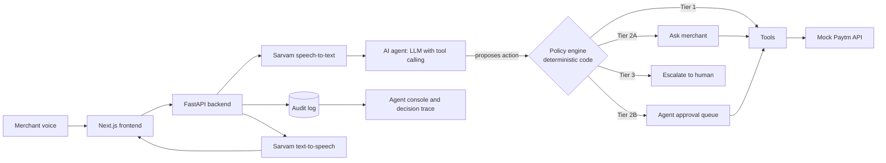

# Paytm Saathi

**A voice-first AI teammate for Paytm Soundbox merchants. It listens in the shopkeeper's language, fixes what it safely can, and hands everything else to a human with the full story.**

> **The AI thinks, plain code decides.**


Built for the Paytm Hackathon (Pune), Track 3: Autonomous AI Teammates.

---

## The problem

When a Soundbox goes silent, the shopkeeper cannot tell whether payments are arriving. Today he calls customer care, waits on hold, and explains the problem from scratch. Paytm reports over 1.6 crore merchants on its subscription plans, so a small problem repeats at very large scale, and every contact costs the merchant time and costs Paytm money.

## What Saathi does

The merchant holds a mic button and speaks in Hindi or English. Saathi:

1. **Understands** the voice note (speech-to-text, language detection).
2. **Investigates by itself**: device status, battery and connectivity, settlement status.
3. **Acts, within limits**: advises a charge, restarts the device after the merchant says yes, or raises a technician request for a human to approve.
4. **Hands off risky cases** (money, fraud, KYC, bank details, anything unclear) to a human, with a complete summary, so the merchant never repeats himself.
5. **Replies by voice** and shows its evidence ("Device offline 18h", "Signal weak").

Battery, update/restart and technician are example scenarios. Saathi is not hardcoded per problem: what it is allowed to do is decided by the action, not the topic (see below).

## The big idea: the AI proposes, code decides

An LLM can be wrong, or be talked into things. So the LLM never grants permission. Every action it proposes passes through a **deterministic policy engine written in ordinary code**.

| Tier | Who decides | Examples |
|---|---|---|
| **Tier 1: Auto** | AI acts alone, every step logged | Read-only checks: device status, settlement status |
| **Tier 2A: Merchant confirms** | The merchant says yes | Restart the Soundbox |
| **Tier 2B: Human approves** | A support agent approves | Dispatch a technician |
| **Tier 3: Humans only** | Saathi does nothing and hands over context | Money movement, KYC, bank details, fraud, low confidence |

Every step (what the merchant said, what the AI proposed, which rule applied, what happened) is written to an audit log and shown in the agent console as a decision trace.

## Architecture



**Stack**

| Layer | Technology |
|---|---|
| Frontend | Next.js, TypeScript, Tailwind CSS |
| Backend | FastAPI, SQLAlchemy, SQLite |
| Speech | Sarvam (speech-to-text and text-to-speech) |
| Agent | LLM with tool calling (Groq) |
| Paytm systems | Mock API with synthetic data |

## What is in the demo

**Merchant app**
- Voice and text chat with a hold-to-speak mic, transcript, detected language and confidence
- Evidence chips and a live "What Saathi is doing" panel
- Confirm card for restarts (Tier 2A)
- My Tickets: each merchant sees only their own tickets
- Hindi and English UI

**Agent console (support staff)**
- Approval queue for technician requests (Tier 2B)
- Escalation inbox with an AI-written summary (Tier 3)
- All tickets and a full decision trace per ticket

**Outcomes dashboard**
- Metrics read from the backend only, labelled as synthetic data

## Demo accounts (mock auth)

Login is a **mock OTP for the prototype**. In production this would be Paytm's existing merchant session.

| Merchant | Phone | Scenario |
|---|---|---|
| Ramesh Kirana Store (Ahmedabad) | 9876543210 | Soundbox silent |
| Meena Tea Stall (Jaipur) | 9876543211 | Settlement delay |
| Sharma Sweets (Lucknow) | 9876543212 | Hardware fault |
| Iqbal General Store (Delhi) | 9876543213 | Fraud dispute |
| Patel Mobile Point (Surat) | 9876543214 | Dual issue |

- **OTP:** `123456`
- **Agent login:** open the Support Agent tab and pick `agent_1`
- Each merchant can only read their own tickets. Merchant tokens cannot call agent routes.

## Run it locally

> Adjust folder names and commands if your repo layout differs.

**Prerequisites:** Python 3.11+, Node 18+, a Groq API key, a Sarvam API key.

**1. Backend**
```bash
cd backend
python -m venv .venv && source .venv/bin/activate   # Windows: .venv\Scripts\activate
pip install -r requirements.txt
cp .env.example .env        # then fill in the keys below
python seed/seed.py         # creates the demo merchants and mock data
uvicorn app.main:app --reload --port 8000
```

`.env`
```
GROQ_API_KEY=your_key
GROQ_MODEL=your_tool_calling_model
SARVAM_API_KEY=your_key
ALLOWED_ORIGINS=http://localhost:3005
```

**2. Frontend**
```bash
cd frontend
npm install
echo "NEXT_PUBLIC_API_BASE_URL=http://localhost:8000" > .env.local
npm run dev -- -p 3005
```

Open http://localhost:3005 and log in with a demo merchant. Use a browser that allows microphone access (Chrome or Edge).

## Try this flow (about 2 minutes)

1. Log in as **Ramesh Kirana Store**. Hold the mic and say "Mera Soundbox band hai", or tap a quick-start chip.
2. Watch Saathi check the device (Tier 1) and propose a restart.
3. Confirm the restart (Tier 2A). The device badge turns Online.
4. Log in as **Iqbal General Store** and say "mere paise kat gaye". Saathi does nothing and escalates (Tier 3).
5. Log in as an agent. Open the Escalation Inbox and the Approval Queue, approve a technician request (Tier 2B), and open the **Decision Trace**.

## Business case (an estimate, not a result)

Public figures and assumptions, clearly separated:

| Input | Value | Source or status |
|---|---|---|
| Merchants on Paytm subscription plans | 1.64 crore | Paytm Q2 FY27 results (public) |
| Human support contact cost | ₹60 to ₹130 | Vendor blog (not independent) |
| Voice AI contact cost | ₹15 to ₹30 | Vendor blog (not independent) |
| Share of devices contacting support per month | 1% / 3% / 5% | **Our assumption** (no public figure) |
| Share of contacts Saathi handles | 50% | **Our target, not measured** |

| Contact rate | Contacts per month | Estimated annual saving |
|---|---|---|
| 1% | 1.6 lakh | about ₹7 crore |
| 3% | 4.8 lakh | about ₹21 crore |
| 5% | 8 lakh | about ₹35 crore |

Formula: devices × contact rate × 12 × (human cost − AI cost) × deflection. Paytm's actual support costs and volumes are unknown to us, so the real saving may be lower. A pilot on real data would replace these assumptions with measured numbers.

## Evaluation

> Fill this in with your real eval output before submitting. Delete rows you did not measure. Do not invent numbers.

| Check | Result |
|---|---|
| Test cases run | [N] across Hindi, English, Hinglish |
| Correct tier decision | [X / N] |
| Restart without merchant confirmation | [0 / N] |
| Technician without agent approval | [0 / N] |
| Policy violations | [0 / N] |
| Average time to resolution (mock) | [value] |

## Security and privacy

- **Merchant-scoped access:** merchant identity comes from the session token, never from the request. A merchant requesting another merchant's ticket gets "not found".
- **Role separation:** console, approvals, escalations and metrics are agent-only routes.
- **No money movement:** Saathi has no tool that moves money or edits bank details.
- **Auditability:** every step is logged and visible in the decision trace.
- **Voice data:** [state what you store, for how long, and how it would be handled in production].

## Limitations (honest status)

- Paytm systems are **mocked**; all merchant, device and settlement data is synthetic.
- Authentication is a mock OTP. Production would use Paytm's existing merchant authentication.
- Speech accuracy varies by language and noise. Published word error rates for Sarvam are about 14.5% for Hindi and about 19.5% for Gujarati, so Saathi shows confidence and escalates when unsure.
- Cost and savings figures are estimates built on public sources and stated assumptions.
- We have not tested with real merchants or on real devices.

## Roadmap

1. **Now:** web prototype, mock data, merchant-scoped access, the tiered policy engine.
2. **Pilot:** run on real device and settlement data with a small merchant group, and measure real cost per ticket and resolution rate.
3. **Next:** inside the Paytm for Business app (no separate website, no extra login), proactive offline alerts, and more languages starting with Gujarati.

This is our roadmap, not an existing integration or agreement with Paytm.

## Repository layout

> Adjust to match your repo.

```
backend/    FastAPI app, agent loop, policy engine, tools, mock Paytm API, seed data, evals
frontend/   Next.js app: merchant app, agent console, outcomes dashboard
docs/       Contracts and design notes
```

## Team

| Name | Role |
|---|---|
| Arushi | Backend |
| Deeptanshu | Frontend |
| Divyanshi Prajapati | AI agent |

## Acknowledgements

Sarvam for Indian-language speech models, and public Paytm disclosures for market figures. Paytm and Soundbox are trademarks of their respective owners; this is an independent hackathon prototype.
